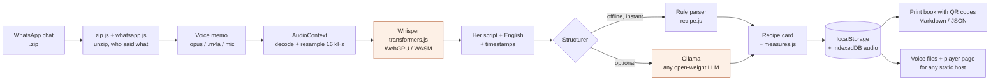

# RecipeMemo 🍲

**Voice Memos to a Family Recipe Book.** Formerly called Nani's Kitchen.

**Turn a grandparent's voice memos into a printable family recipe book. Entirely on your own laptop.**

My grandmother does not write recipes down. She has never written one down. What she does is send
four-minute WhatsApp voice notes that start with "okay so today I am going to make" and end with an
unrelated story about the coal fire. Those memos are the recipes. They are also the only copy.

RecipeMemo takes those memos, transcribes them with **Whisper running inside the browser tab**,
pulls out ingredients, method and the stories, and builds a recipe book you can print and hand over.

No server. No API key. No account. The audio never leaves the machine.

---

## Why it had to be open

This is the part that is not a technicality.

Uploading a recording of your grandmother to somebody's inference API is a thing you only do once
without thinking about it. The audio is her voice, her house, her health, whatever else is audible in
the background, and often a language she speaks and a cloud ASR vendor charges extra for. A closed
API makes "it is private" a promise in a terms-of-service document. Open weights make it a property
of where the code runs.

Concretely, open innovation bought four things here:

| | Closed API | This |
|---|---|---|
| **Where the audio goes** | Someone's bucket | `AudioContext` → WASM/WebGPU in the tab |
| **Cost for 200 memos** | Per-minute billing | Zero, forever |
| **Offline** | No | Yes, after the first model download |
| **Swapping the brain** | Whatever the vendor ships | tiny / base / small, or any Ollama model |

The model-swap row is the one that mattered during the build. `whisper-tiny.en` is 40 MB and runs
instantly on an old laptop, which is the machine this will actually live on. `whisper-small.en` is six
times bigger and noticeably better at accented English. You pick per-machine, at runtime, from a
dropdown. No closed API lets you make that trade yourself.

---

## What it does

- **Transcribes on-device.** Whisper via `transformers.js`, WebGPU when available, CPU/WASM otherwise.
- **Imports WhatsApp.** Drop a whole chat export (.zip) or one shared voice note (.opus). The zip is
  opened in the tab with the browser's own `DecompressionStream`, and the chat text says who sent each
  note and what was asked just before it. Tick three notes in a row and they become one memo.
- **Hears Hindi, Punjabi and Tamil.** Her words come out in her own script, plus an English version
  for a bilingual book. How well each language works is measured below. Punjabi is the weak one.
- **Turns rough measures into cups and grams.** "Ek mutthi chawal" stays as she said it, with
  "about ¼ cup, 50 g" beside it. Katori, chutki, chammach, glass and paav work too, in Roman Hindi,
  Devanagari, Gurmukhi and Tamil.
- **Keeps the timestamps.** Every ingredient and every step has a ▶ button that replays the exact
  second she said it. The transcript is a reference. Her voice is the source of truth.
- **Separates the story from the method.** Spoken recipes are 40% memory. A line like *"when I was a
  girl we had no gas, only the coal fire"* is not an instruction and should not be deleted either.
  It lands in an **In her words** section.
- **Understands spoken quantities.** "A pinch", "plenty of ghee, do not be shy with it", "about two
  cups of atta, that is the wheat flour". Vague stays vague. It is not invented into `250 g`.
- **Two brains, one dropdown.** A deterministic parser that runs offline and instantly, or any
  open-weight LLM you have in Ollama.
- **Prints a real book.** Page sizes from Notion Press, margins that mirror for binding, page
  numbers, fonts named for all three scripts. Each recipe page can carry a QR code that plays her
  voice. Markdown and JSON exports too.

## Architecture



Everything in that diagram runs on the user's machine. The only network call in the entire app is the
one-time model download from the Hugging Face Hub, which the browser then caches.

## Run it

```bash
git clone https://github.com/VanshajPoonia/nanis-kitchen
cd nanis-kitchen
python3 -m http.server 8000
# open http://localhost:8000
```

It is static files. Any web server works, including GitHub Pages. There is no build step and no
`node_modules`.

**Try it without a microphone:** load the model, then hit *Use the sample memo* for a real spoken
transcript of an aloo paratha recipe, and press *Make a recipe card*.

## Hindi, Punjabi and Tamil

Pick the language she speaks. The app switches to `whisper-small`, the smallest model that writes
Hindi in Devanagari (see below). Transcription runs twice: once in her language, once with Whisper's
translate task for the English version. Both boxes stay editable.

<!-- ASR RESULTS -->

## WhatsApp voice notes

On the phone, open the chat, tap the name at the top, then **Export chat** and **Attach media**.
Send the .zip to the computer and drop it on the page. iPhone (`_chat.txt`, `AUDIO-…opus`) and
Android (`WhatsApp Chat with ….txt`, `PTT-…opus`) exports both work, in day-first or month-first
date formats. A chat exported without media gets a message saying to export it again.

WhatsApp voice notes are Opus audio in an Ogg file. The browser's own Web Audio decoder handles them:

| Browser | Decodes .opus voice notes |
|---|---|
| Chrome, Edge | Yes |
| Firefox | Yes |
| Safari 18.4+ (macOS 15.4, iOS 18.4) | Yes, Apple added Ogg Opus in 18.4 ([release notes](https://developer.apple.com/documentation/safari-release-notes/safari-18_4-release-notes)) |
| Older Safari | No. The app says so and suggests another browser |

The zip reader and writer are 177 lines in `src/zip.js`. The reader reads the central directory, inflates with
`DecompressionStream('deflate-raw')` and checks every file's CRC. Tests run it on zips made by the
system `zip -9`.

## Rough measures

| She says | Roughly |
|---|---|
| chutki, चुटकी, ਚੁਟਕੀ, சிட்டிகை (pinch) | under ⅛ tsp |
| mutthi, मुट्ठी, ਮੁੱਠੀ, கைப்பிடி (fistful) | ¼ cup |
| chammach, चम्मच, ਚਮਚ, கரண்டி (everyday spoon) | 2 tsp. Chhota is 1 tsp, bada is 1 tbsp |
| katori, कटोरी, ਕੌਲੀ, கிண்ணம் (small bowl) | ⅔ cup |
| glass, गिलास, ਗਲਾਸ | 1 cup |
| tumbler, டம்ளர் | ¾ cup |
| paav, पाव, ਪਾਈਆ (quarter kilo) | 250 g |

One cup is 240 ml. Grams come from a rough density for 14 common ingredients (atta, besan,
rice, dal, sugar, salt, ghee, dahi and so on), and only for the word right next to the measure.
Numbers like dedh, dhai, sava do and paune do, and Devanagari, Gurmukhi and Tamil digits are read
too. "Pav bhaji" is not a measure. The printed book opens with this table so nobody has to guess.

## QR codes that play her voice

*Export voice files for QR codes* downloads a zip with one small player page and the original
recordings. Put that folder on any static host, paste its address into the book settings, and export
the book again. Each recipe page then carries a QR code for `<address>/#<recipe id>`, which opens
the player and plays her voice. The player page asks search engines not to index it.

The QR encoder is written from the spec in `src/qr.js` (byte mode, error correction level M, which
survives about 15% damage). Tests pin it against the spec's Reed-Solomon, format and version values.
`evals/qr.mjs` decodes 121 generated codes with Apple's CoreImage detector, versions 1 to 15 with
every mask, and all 121 come back exact.

## Printing the book

*Export printable book* writes one HTML file. Open it in Chrome, print, and choose **Save as PDF**.
Keep **Margins: Default** and turn off **Headers and footers**. The page size comes from the book:

| Page size | Notes |
|---|---|
| 5 × 8 in, 5.5 × 8.5 in, 6 × 9 in | Trade paperback sizes. 6 × 9 is the default |
| 8.5 × 8.5 in | Notion Press suggests it for cookbooks |
| 8.5 × 11 in | Large format |

These are the sizes on Notion Press's [book formats page](https://notionpress.com/resources/book-formats-and-sizes).
Inside margins are wider than outside ones and swap sides on left and right pages, so text never
disappears into the spine. Nothing prints to the edge, so no bleed is needed. Devanagari, Gurmukhi
and Tamil use fonts that ship with macOS and Windows (Kohinoor Devanagari, Mukta Mahee, Tamil Sangam
MN, Nirmala UI), and Chrome embeds them in the PDF. Check the PDF against your printer's current
interior rules before ordering.

## Tests and evals

```bash
npm test
```

167 checks, no model and no browser needed: the spoken-recipe parser, the zip reader and writer,
iPhone and Android WhatsApp exports, measures in four languages and three scripts, the QR encoder,
the printed book, the WAV joiner, script detection and the eval metrics.

The speech eval runs the same models and settings as the app, in Node:

```bash
npm i --no-save @huggingface/transformers@3.7.5
node evals/prep.mjs /tmp/recipememo-eval 10     # FLEURS clips + synthetic memos (macOS `say`)
node evals/asr.mjs /tmp/recipememo-eval evals/results/asr.json
node evals/qr.mjs evals/results/qr.json          # macOS, uses CoreImage
node evals/sample-book.mjs /tmp/sample.html 8.5x8.5
```

### Optional: structure with a local LLM

```bash
brew install ollama
ollama pull llama3.2        # or gpt-oss, qwen2.5, mistral, whatever you like
OLLAMA_ORIGINS=* ollama serve
```

The app probes `localhost:11434`, lists whatever you have pulled, and uses it instead of the rule
parser. `OLLAMA_ORIGINS=*` is needed so the browser is allowed to talk to it. The local LLM works on
the English text.

## Browser support

| | Whisper | Notes |
|---|---|---|
| Chrome / Edge 113+ | WebGPU | Fastest, roughly realtime on `base.en` |
| Safari 17+ | WASM | Works, slower. WhatsApp .opus notes need 18.4+ |
| Firefox | WASM | Works, slower |

A two-minute memo on `whisper-base.en` takes about 20 seconds on WebGPU and about 90 on WASM.

## Project layout

```
index.html          single page
assets/styles.css   light + dark, no framework
src/asr.js          Whisper pipeline, audio decode, resampling, language and task
src/scriptguard.js  keeps Hindi in Devanagari and Punjabi in Gurmukhi
src/recipe.js       spoken-transcript → structured recipe (the interesting file)
src/measures.js     katori, mutthi, chammach → cups, spoons, grams
src/zip.js          zip reader and writer, no library
src/whatsapp.js     WhatsApp chat export parser
src/qr.js           QR code encoder
src/book.js         localStorage, print book, voice files, Markdown/JSON
src/audiostore.js   voice notes in IndexedDB
src/wav.js          joins several voice notes into one memo
src/ollama.js       optional local LLM path
src/app.js          UI wiring
evals/              speech, QR and print-sample scripts, results in evals/results
```

The parser in `src/recipe.js` is the part worth reading. Written recipes and spoken recipes are
different languages, and almost all recipe-parsing code assumes the written one.

## Honest limitations

- Heavy accents plus kitchen noise will still trip `tiny`. Move up to `small.en`.
- Ingredient splitting is heuristic. A run-on sentence occasionally produces a run-on line, which is
  why the title is editable and the export is plain Markdown you can fix in ten seconds.
- The recipe parser reads English. For Hindi, Punjabi and Tamil it structures the English version and
  prints her own words beside it.
- Measures are rough on purpose. A katori is whatever bowl she had.
- The book lives in `localStorage` and the voices in IndexedDB. Export them. JSON export does not
  carry audio, so keep the voice files zip too.
- Fonts come from the computer that prints. A machine with no Devanagari, Gurmukhi or Tamil font
  will show boxes.

## License

MIT. The Whisper weights are Apache-2.0 from OpenAI, served via the Hugging Face Hub.
